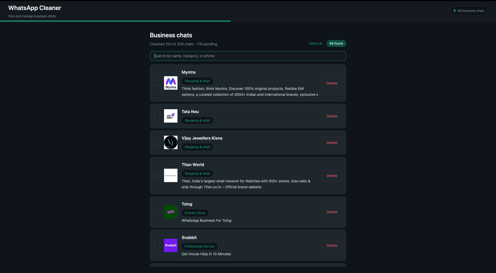

# WhatsApp Cleaner

A desktop app for finding and deleting business chats from your WhatsApp account.



## What it does

- Links to WhatsApp by QR code
- Reads chats from history sync and filters direct chats to business accounts
- Shows profile picture, verified name, category, and description
- Search by name, category, or phone number
- Select chats individually or select all filtered results
- Deletes chats (and their media) across linked devices

## Stack

- [GPUI](https://gpui.rs) — GPU-accelerated UI (`gpui-pre` snapshots)
- [whatsapp-rust](https://github.com/oxidezap/whatsapp-rust) — WhatsApp Web client
- `qrcode` + `image` — QR pairing and avatars

## Run

```sh
cargo run
```

Scan the QR from **WhatsApp → Settings → Linked devices → Link a device**.

Requires a recent stable Rust toolchain on macOS.

## Notes

- Sessions are intentionally ephemeral: the app starts unpaired every launch and stores nothing across runs.
- Only chats delivered in WhatsApp history sync can appear.
- Delete sends a `deleteChat` app-state mutation with the chat's last-message range, matching WhatsApp Web behavior. It removes the chat and its media from your account.
- This project uses an unofficial WhatsApp client. Use at your own risk.
